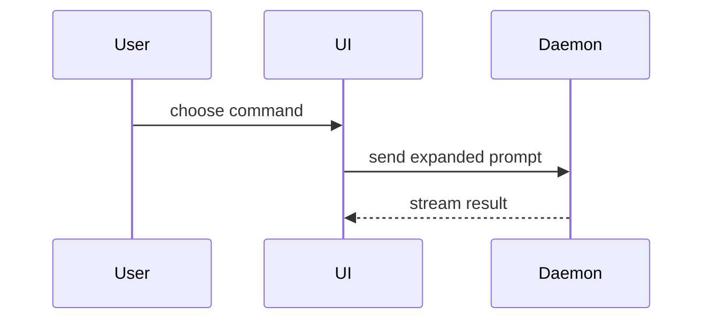

使用以下模板撰写 PR 正文：

> 该模板保留英文——它是发布到 PR 上的实际文本格式；各字段含义见行内中文注释。

```markdown
## Summary    # 摘要

<diagram, diff-sketch, or tree>    # <图示、diff 草图或树形图>

## Evidence    # 证据

- **Before:** <screenshot/output/failing test run>    # **之前：**<截图/输出/失败的测试运行>
  **After:** <screenshot/output/passing test run>    # **之后：**<截图/输出/通过的测试运行>

## Merge Danger    # 合并风险

**Door:** <one-way or two-way>    # **门：**<单向或双向>

<optional: description>    # <可选：描述>

**Blast Radius:** <one-word description>    # **爆炸半径：**<一个词描述>

<optional: potential ramifications of merge>    # <可选：合并的潜在后果>
```

## 小节

跳过所有开场白，行文保持简短。使用 `GLOSSARY.md` 中的用户领域语言。

### Summary（摘要）

挑选能把关键点讲清楚的最小视图。

> 本小节及下文的图示与代码示例保留英文——它们演示的是要写进 PR 正文的实际内容形态。

- 用伪代码展示逻辑或算法：

```text
on(save)
  if content is unchanged
    return cached result
  write new content
  return fresh result
```

- 用调用树展示运行时控制流：

```text
submitForm
  createSession
    persistPrompt
    launchAgent
  navigateToSession
```

- 用组件树展示 UI 结构，包括重要的状态和模块边界：

```text
<SessionPage> (apps/example/src/routes/session.tsx)
  useSessionEvents()
  <SessionToolbar>
    <RunSkillButton> (packages/ui)
```

- 用浅层文件树展示文件职责或一次宽幅重构：

```text
src/
├── commands/       # parses user actions
├── sessions/       # owns session state
└── transport/      # sends API requests
```

- 用 Mermaid 展示组件交互、控制流或数据流：



- 当要点在于"改变了什么"且周边形态已经存在时，使用 `diff`。让 diff 的形态匹配主题。

组件改动：

```diff
 <SessionPage>
   useSessionEvents()
   <SessionToolbar>
+    <RunSkillButton />
   <SessionTimeline>
+    <SkillResultCard />
```

文件布局改动：

```diff
 src/
 ├── commands/
+│   └── show-me.ts       # expands the slash command
 ├── sessions/
-└── transport.ts
+└── transport/
+    ├── client.ts
+    └── stream.ts
```

调用树或调用栈改动：

```diff
 submitForm
   createSession
     persistPrompt
+    expandSkillMention
     launchAgent
-  navigateToSession
+  navigateToSession
+    subscribeToEvents
```

状态或控制流改动：

```diff
 on(save)
-  write content
+  if content is unchanged
+    return cached result
+  write new content
+  invalidate cache
```

- 当大部分内容是新的、省略上下文会掩盖归属或顺序、或用户需要一个可复制的目标形态时，展示完整代码块：

```ts
function expandSkill(command: string): string {
  const skillName = command.slice(1);
  return `use the ${skillName} skill`;
}
```

#### 指引

把每个图示放在它所支撑的那段简短文字旁边。只保留回答用户当前问题、或解决当前讨论点的选项所需的调用、文件、props、状态和边界。

这些图示你可以用一个，也可以用好几个，但不太可能全部用上。运用你的判断，不要让用户不堪重负。

### Evidence（证据）

证明改动有效的具体证据。展示前后对比。

截图是 S 级——当环境已经为此配置好、且改动是视觉性的时。

基于执行的证据是 A 级。测试结果、控制台输出。用伪代码展示那个现在由失败变为通过的确切测试。

### Merge Danger（合并风险）

描述这是一扇单向门还是双向门。双向门可以走回来，单向门不行。回滚成本低的 PR 风险更低。涉及破坏性操作或难以逆转的决策的改动是单向门。

爆炸半径是这个 PR 引入的改动的潜在影响或范围。考虑所有可能性。例如布局偏移、对消费方的破坏、移动端响应式等。
